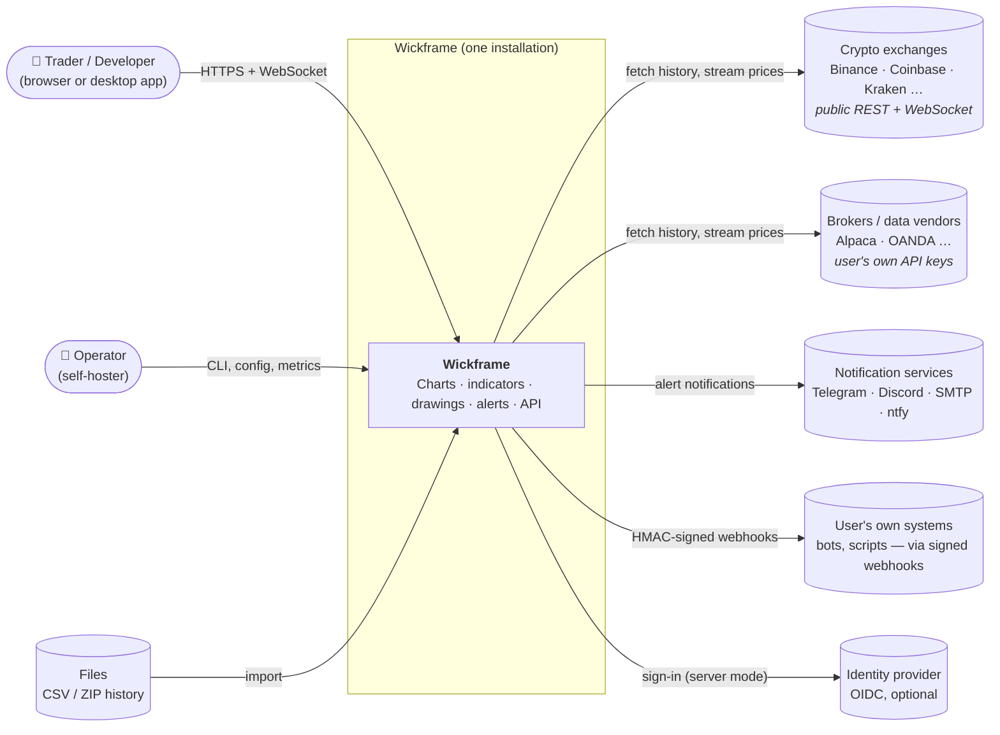

# Architecture Overview

| | |
|---|---|
| **Status** | Accepted (living document) |
| **Last reviewed** | 2026-11-13 |
| **Method** | [arc42](https://arc42.org/overview) structure, [C4 model](https://c4model.com/) diagrams, decisions in [ADRs](../adr/README.md) |

This is the entry point to the architecture documentation. It covers arc42 sections
1–4: goals, constraints, context and solution strategy. The remaining sections each
have their own document (see the [index](#7-document-map)).

## 1. Introduction and quality goals

Wickframe is a self-hostable charting and technical-analysis platform
([vision](../product/vision.md)). Functional scope is defined in
[requirements](../product/requirements.md).

**Top quality goals,** in priority order. When goals conflict, the higher one wins.

| # | Quality goal | Motivation | Key requirements |
|---|---|---|---|
| Q1 | **Correctness** of data and indicators | Traders act on what they see. A wrong value destroys trust. | FR-DATA-08, FR-IND-02, FR-IND-04 |
| Q2 | **Reliability** of real-time data and alerts | Alerts that silently stop are worse than no alerts. | FR-ALERT-09/10, NFR-REL-* |
| Q3 | **Responsiveness** of the chart | Charting is an interactive, latency-sensitive experience. | NFR-PERF-01…03 |
| Q4 | **Operability** (install, upgrade, back up) | Self-hosters and desktop users have no ops team. | FR-OPS-*, NFR-UX-01 |
| Q5 | **Security and privacy** | Credentials and trading intent are sensitive. | NFR-SEC-* |
| Q6 | **Extensibility** | New data sources and indicators drive the project's growth. | FR-DATA-01, FR-IND-06 |

**Stakeholders**

| Role | Expectation |
|---|---|
| End users (P1–P4) | A fast, correct, private tool that is easy to run. |
| Self-host operators | One artifact, safe upgrades, observability, backups. |
| Contributors | Clear module boundaries, documented decisions, fast tests. |
| Connector authors | A stable, documented connector interface with a conformance test kit. |
| Maintainers | A sustainable scope and an automated quality gate. |

## 2. Constraints

| Type | Constraint | Source |
|---|---|---|
| Organisational | Very small team; AI-assisted development; no budget for paid infrastructure or data. | Project context |
| Legal | AGPL-3.0-only; DCO for contributions; no market-data redistribution. | [ADR-0002](../adr/0002-license-agpl-3.0.md), [ADR-0006](../adr/0006-bring-your-own-market-data.md) |
| Product | No order execution; no runtime AI; no app-store mobile apps. | [Vision §5](../product/vision.md#5-non-goals) |
| Technical | Go backend, single static binary (`CGO_ENABLED=0`); SQLite and PostgreSQL; browser UI. | [ADR-0003](../adr/0003-go-modular-monolith.md), [ADR-0004](../adr/0004-storage-sqlite-and-postgresql.md) |
| Technical | Must run on Linux (amd64, arm64), macOS and Windows. | NFR-MAINT-03 |
| External | Data-source rate limits, connection limits and terms of use vary per source and change over time. | [Market data](04-market-data.md) |

## 3. Context and scope (C4 level 1)

**In scope:** everything inside the Wickframe box: data ingestion, storage,
indicator computation, charting UI, alert evaluation and notification delivery,
the API, and user and account management.

**Out of scope:** market data itself (provided by external sources), order
execution, external identity management, and the user's downstream automation
(reached through webhooks).

**External interfaces**

| Interface | Direction | Protocol | Notes |
|---|---|---|---|
| Web UI / desktop | in | HTTPS, WebSocket `wickframe.v1` | [API](09-api.md), [real-time](05-realtime.md) |
| Public API | in | HTTPS REST, OpenAPI 3.1 | Token auth |
| Market data sources | out | HTTPS REST, WebSocket, chunked HTTP | Per-connector adapters; [market data](04-market-data.md) |
| Notifications | out | HTTPS APIs, SMTP | [Alerts](07-alerts.md) |
| Webhooks | out | HTTPS POST, HMAC-SHA256 | [Alerts](07-alerts.md#6-webhook-signing) |
| OIDC | out/in | OpenID Connect | Server mode, optional |
| Operations | in | CLI, `/metrics`, `/livez`, `/readyz` | [Observability](12-observability.md) |

## 4. Solution strategy

| Quality goal | Strategy |
|---|---|
| Q1 Correctness | A single indicator engine shared by charts and alerts ([ADR-0010](../adr/0010-single-indicator-engine.md)); reference-verified indicator tests; canonical UTC candle model with explicit forming/closed state and gap tracking. |
| Q2 Reliability | Supervised connectors with backoff and backfill; durable alert state; at-least-once notification delivery with an outbox; lossless internal delivery to the alert engine ([ADR-0008](../adr/0008-realtime-transport.md)). |
| Q3 Responsiveness | Canvas chart engine; local candle cache; incremental indicator updates; a conflating WebSocket fan-out that always delivers the latest bar. |
| Q4 Operability | A Go modular monolith as one static binary with the UI embedded; SQLite with zero config; automatic migrations; built-in backup commands; health endpoints and metrics. |
| Q5 Security | Secure defaults (loopback-only without auth), server-side sessions, Argon2id, encrypted secrets, signed releases with SBOM and provenance; the ASVS L2 target in server mode ([security](11-security.md)). |
| Q6 Extensibility | A versioned connector interface with a conformance kit; an indicator registry; a sandboxed scripting engine later ([ADR-0011](../adr/0011-scripting-engine.md)). |

**Key technology choices** (details and alternatives in the ADRs):

| Layer | Choice |
|---|---|
| Backend language and runtime | Go 1.27, single binary ([ADR-0003](../adr/0003-go-modular-monolith.md)) |
| Storage | SQLite (modernc) and PostgreSQL (pgx v5), sqlc, goose ([ADR-0004](../adr/0004-storage-sqlite-and-postgresql.md)) |
| HTTP API | huma v2 on `net/http`, OpenAPI 3.1, RFC 9457 errors ([ADR-0007](../adr/0007-http-api-openapi-huma.md)) |
| Real-time | WebSocket (coder/websocket) plus an in-process conflating hub ([ADR-0008](../adr/0008-realtime-transport.md)) |
| Frontend | React + TypeScript + Vite ([ADR-0012](../adr/0012-frontend-stack.md)) |
| Chart engine | See [ADR-0005](../adr/0005-chart-engine.md) |
| Desktop | See [ADR-0009](../adr/0009-desktop-shell.md) |
| Observability | slog, Prometheus, optional OpenTelemetry ([ADR-0013](../adr/0013-observability.md)) |
| Auth | Server-side sessions, Argon2id, OIDC, WebAuthn ([ADR-0014](../adr/0014-authentication.md)) |
| Supply chain | GoReleaser, cosign, SBOM, build attestations ([ADR-0015](../adr/0015-supply-chain-and-release.md)) |

## 5. Operating modes

One binary runs in two modes. The mode is configuration, not a separate build.

| | **Personal mode** (default) | **Server mode** |
|---|---|---|
| Typical deployment | Desktop app, or `wickframe serve` on a laptop | Docker / VM / Kubernetes, 24/7 |
| Database | SQLite (file in the data directory) | PostgreSQL 16+ (SQLite allowed for a single user) |
| Users | One implicit owner, no login | Accounts, roles, sessions, API tokens |
| Network exposure | Binds to `127.0.0.1` only. Refuses to bind elsewhere unless auth is enabled. | Behind a TLS-terminating reverse proxy, or built-in TLS |
| Alerts | Evaluated while the app is running | Evaluated continuously |
| Config key | `mode: personal` | `mode: server` |

## 6. Architectural principles and rules

1. **Dependency rule (hexagonal architecture).** Domain packages
   (`internal/<module>`) depend on nothing outside the standard library and other
   domain types. Adapters (HTTP, WebSocket, storage, connectors, notifiers) depend
   on the domain, never the reverse. This is enforced by an architecture test.
2. **Modules own their data.** A module accesses only its own tables, through its
   own repository interface. Cross-module needs go through a module's public Go
   interface or bus events.
3. **Time is explicit.** All timestamps are UTC milliseconds internally. Time
   zones exist only at the edges (session definitions and display). Code obtains
   time from an injected `Clock` so it is testable.
4. **Context everywhere.** Every blocking call takes a `context.Context`; every
   goroutine has an owner responsible for stopping it (no leaks; checked with the
   goroutine-leak profile and tests).
5. **Fail loudly, recover automatically.** Errors are wrapped with context, logged
   once at the boundary, counted in metrics, and surfaced in the UI when
   user-relevant. Supervisors restart failed components with backoff.
6. **Configuration is validated at startup** and is immutable at runtime, except
   for user-managed settings stored in the database.
7. **No hidden network calls.** The only outbound connections are those the user
   configured: data sources, notifiers, OIDC. No telemetry by default.

## 7. Document map

| Doc | arc42 section | Content |
|---|---|---|
| [01 Containers](01-containers.md) | 5 (L1–L2) | Runtime containers, deployment variants |
| [02 Components](02-components.md) | 5 (L3) | Backend modules, interfaces, dependency rules |
| [03 Domain model](03-domain-model.md) | 8 | Core concepts and invariants |
| [04 Market data](04-market-data.md) | 6, 8 | Connectors, ingestion, aggregation, backfill |
| [05 Real-time](05-realtime.md) | 6 | Event hub, WebSocket protocol, back-pressure |
| [06 Indicators](06-indicators.md) | 8 | Indicator engine, verification |
| [07 Alerts](07-alerts.md) | 6, 8 | Alert engine, notifications, delivery guarantees |
| [08 Storage](08-storage.md) | 8 | Schemas, dialects, retention, migrations, backup |
| [09 API](09-api.md) | 8 | REST conventions, versioning, errors |
| [10 Frontend](10-frontend.md) | 5, 8 | Web application architecture |
| [11 Security](11-security.md) | 8 | Threat model, authentication and authorisation, secrets |
| [12 Observability](12-observability.md) | 8 | Logs, metrics, traces, health |
| [13 Deployment](13-deployment.md) | 7 | Distribution, configuration, upgrades |
| [14 Quality](14-quality.md) | 10 | Quality scenarios, test strategy |
| [15 Risks](15-risks.md) | 11 | Risks and technical debt |
| [Glossary](glossary.md) | 12 | Terms |
