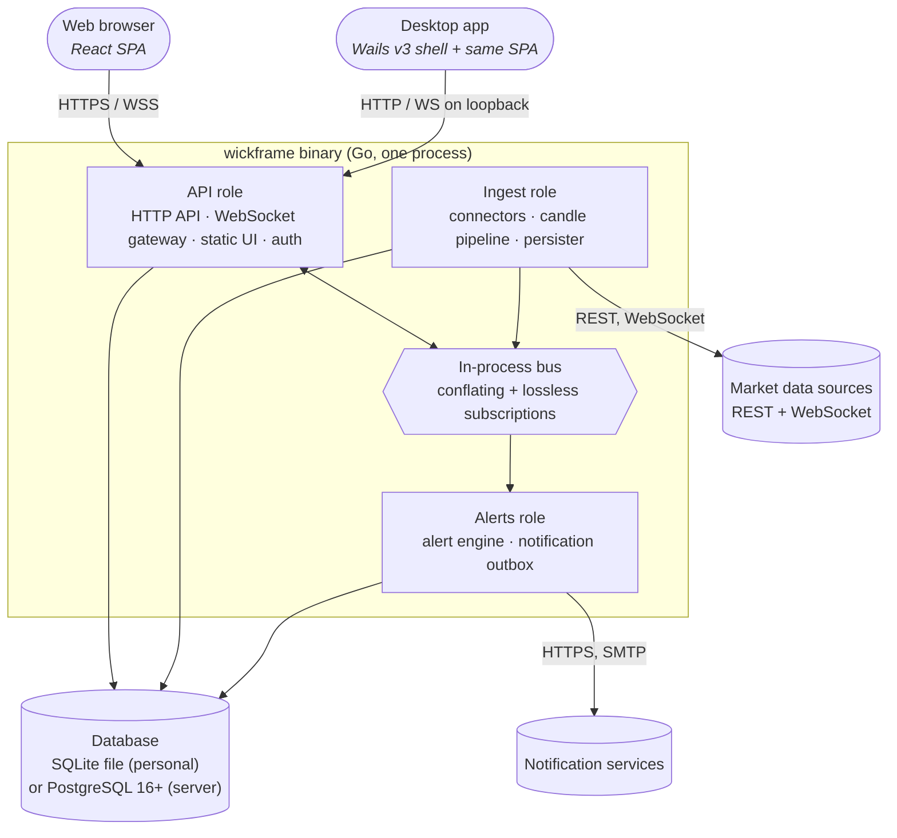

# 01 · Containers and Deployment Variants (C4 Level 2)

| | |
|---|---|
| **Status** | Accepted |
| **Last reviewed** | 2026-11-13 |

In C4 terms, a *container* is a separately runnable or deployable unit (a process,
an application or a data store), not specifically a Docker container.

## 1. Container diagram — default deployment (`--target=all`)



| Container | Technology | Responsibility |
|---|---|---|
| **Web SPA** | React 19, TypeScript 7, Vite 8 ([ADR-0012](../adr/0012-frontend-stack.md)) | All UI: charts, drawings, watchlists, alert management, settings. Embedded in the binary with `embed.FS`. |
| **Desktop shell** | Wails v3 ([ADR-0009](../adr/0009-desktop-shell.md)) | Native window and installer; starts the backend in personal mode and loads the SPA. |
| **wickframe binary** | Go 1.27 ([ADR-0003](../adr/0003-go-modular-monolith.md)) | All backend roles. Roles are internal groupings of modules and run together by default. |
| **Database** | SQLite (modernc) or PostgreSQL 16+ (pgx) ([ADR-0004](../adr/0004-storage-sqlite-and-postgresql.md)) | User data, candles, alert state, notification outbox, audit log. |

## 2. Roles

| Role | Owns | Notes |
|---|---|---|
| `api` | `internal/api/http`, `internal/api/ws`, `internal/auth`, static UI | Stateless apart from WebSocket sessions. |
| `ingest` | `internal/marketdata` (connectors, aggregation, backfill), candle persistence | Holds source connections; one owner per (source, stream). |
| `alerts` | `internal/alert`, `internal/notify` | Holds alert evaluation state; drains the notification outbox. |

`--target=all` is the only supported production topology until a network bus is
introduced (ADR-0003). Selecting roles today is used for testing and for
validating the module boundaries.

## 3. Deployment variants

### 3.1 Personal — desktop

```text
┌──────────────── User's computer ─────────────────┐
│  Wickframe.app / .exe                            │
│   ├─ Wails webview ── http://127.0.0.1:<random> ─┐│
│   └─ Go backend (personal mode) ◀────────────────┘│
│        └─ SQLite: <OS app-data dir>/wickframe.db  │
└──────────────────────────────────────────────────┘
```

### 3.2 Personal — CLI

`wickframe serve` binds `127.0.0.1:7317` by default (port chosen to avoid common
conflicts; configurable). The data directory follows the XDG base-directory
specification on Linux, and the platform equivalents on macOS and Windows.

### 3.3 Server — single host (reference)

```text
                Internet / LAN
                      │ HTTPS 443
              ┌───────▼────────┐
              │ Reverse proxy  │  Caddy / Traefik / nginx (TLS, HTTP/2)
              └───────┬────────┘
                      │ HTTP 7317 (private network)
              ┌───────▼────────┐      ┌──────────────────┐
              │ wickframe      │─────▶│ PostgreSQL 16+   │
              │ (OCI image,    │      │ (volume, backups)│
              │  non-root)     │      └──────────────────┘
              └───────┬────────┘
                      │ outbound only: data sources, notifiers, OIDC
```

The `docker-compose.yml` in the repository is the reference for this variant
([deployment](13-deployment.md)).

### 3.4 Server — Kubernetes (community-supported)

A Helm chart is a later deliverable (M3+). Constraints: **one replica**
(`replicas: 1`, `strategy: Recreate`) until multi-process roles are supported. The
readiness probe is `/readyz` and the liveness probe is `/livez`. PostgreSQL is
external.

## 4. Network ports and protocols

| Port | Protocol | Purpose | Exposure |
|---|---|---|---|
| 7317 | HTTP/1.1 + HTTP/2 (h2c optional), WebSocket | UI, API, WS, `/livez`, `/readyz` | Loopback (personal); private network behind a proxy (server) |
| 7318 (optional) | HTTP | Admin listener: `/metrics`, `/debug/pprof` | Never public |
| Outbound 443 | HTTPS/WSS | Data sources, notifications, OIDC | As configured by the user |
| Outbound 25/465/587 | SMTP | Email notifications | As configured |
