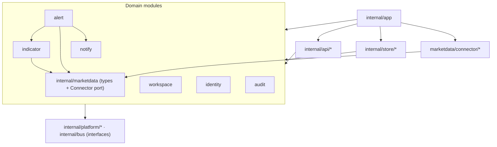

# 02 · Backend Components (C4 Level 3)

| | |
|---|---|
| **Status** | Accepted |
| **Last reviewed** | 2026-11-13 |

This document defines the backend's modules, their responsibilities, their public
interfaces and the rules about which may depend on which. The code layout is in
[repository layout](../engineering/repository-layout.md).

> The Go signatures below are **illustrative contracts**. They fix responsibilities
> and data flow, not final parameter names. The implementation may refine them
> through normal review, as long as these rules still hold.

## 1. Architectural style

A **modular monolith with a hexagonal (ports and adapters) structure inside each
module** ([ADR-0003](../adr/0003-go-modular-monolith.md)):

```text
            ┌──────────── driving adapters ────────────┐
            │  internal/api/http   internal/api/ws  CLI │
            └───────────────┬──────────────────────────┘
                            ▼  calls services (ports)
   ┌──────────────────── domain modules ─────────────────────┐
   │ marketdata · indicator · workspace · alert · notify ·   │
   │ identity · audit           (pure Go, no I/O imports)    │
   └───────────────┬─────────────────────────────────────────┘
                   ▼  through interfaces the domain defines
            ┌──────────── driven adapters ─────────────┐
            │ store/sqlite · store/postgres · connectors│
            │ notify channels · bus implementation      │
            └───────────────────────────────────────────┘
```

## 2. Module catalogue

| Module | Package | Responsibility | Owns tables | Role |
|---|---|---|---|---|
| **App** | `internal/app` | Composition root: builds every module from config, wires adapters, starts and stops roles under a supervisor. The **only** package that knows every module. | — | all |
| **Config** | `internal/config` | Loads, merges (file → env → flags), validates, and exposes typed config. | — | all |
| **Platform** | `internal/platform/...` | Cross-cutting utilities with no business meaning: `clock`, `id` (UUIDv7), `secret` (encryption at rest), `logx`, `metricsx`, `supervise`, `retry`. | — | all |
| **Bus** | `internal/bus` | In-process pub/sub with conflating and lossless subscriptions ([real-time](05-realtime.md)). | — | all |
| **Market data** | `internal/marketdata` | Instrument catalogue; connector registry and supervision; candle pipeline (normalise → aggregate → publish → persist); history loading, gap detection and backfill. | `data_sources`, `instruments`, `candles`, `candle_gaps` | ingest |
| **Connectors** | `internal/marketdata/connector/<name>` | One adapter per source (binance, coinbase, kraken, alpaca, csv, …), implementing `Connector`. | — | ingest |
| **Indicators** | `internal/indicator` | Indicator registry, streaming implementations, a series cache, and output metadata. | — (computed) | api, alerts |
| **Workspace** | `internal/workspace` | Layouts, drawings, watchlists, chart templates, user preferences. | `layouts`, `drawings`, `watchlists`, `watchlist_items`, `preferences` | api |
| **Alerts** | `internal/alert` | Alert definitions, compiled conditions (expr), evaluation state machine, firing history. | `alerts`, `alert_state`, `alert_events` | alerts |
| **Notify** | `internal/notify` | Notification channels, templates, a transactional outbox, delivery workers with retry. | `notification_channels`, `notification_outbox`, `notification_attempts` | alerts |
| **Identity** | `internal/identity` | Users, roles, password credentials, sessions, API tokens, OIDC and WebAuthn linking. | `users`, `sessions`, `api_tokens`, `credentials` | api |
| **Audit** | `internal/audit` | Append-only security audit log. | `audit_log` | all |
| **HTTP API** | `internal/api/http` | huma operations: request mapping, authN/authZ middleware, Problem Details errors ([API](09-api.md)). | — | api |
| **WebSocket gateway** | `internal/api/ws` | `wickframe.v1` protocol, per-client subscriptions, back-pressure ([real-time](05-realtime.md)). | — | api |
| **Store adapters** | `internal/store/{sqlite,postgres}` | Implement every repository interface; migrations; sqlc code. | — | all |
| **Script** (M4) | `internal/script` | Sandboxed user indicators ([ADR-0011](../adr/0011-scripting-engine.md)). | `scripts` | api, alerts |
| **Plugin host** (M4) | `internal/plugin` | Out-of-process connector plugins ([ADR-0016](../adr/0016-connector-extension-model.md)). | — | ingest |
| **Connector test kit** | `pkg/connectortest` | **Public** conformance tests for connector authors. | — | — |

`pkg/` contains only packages that are deliberately public and SemVer-stable.
Everything else lives in `internal/`, so the Go toolchain prevents outside imports.

## 3. Dependency rules



Rules (enforced by `internal/archtest`, which runs in CI):

1. **Domain modules** may import only the standard library, `internal/platform/*`,
   `internal/bus` (interfaces only), and the *public API packages* of other domain
   modules shown as edges in the diagram. The graph must be **acyclic**.
2. Domain modules must **not** import `internal/api/*`, `internal/store/*`,
   connector packages, `net/http` servers, database drivers, or any third-party
   I/O library. (Exception: `internal/alert` may import `expr-lang/expr`, a pure
   computation library.)
3. **Adapters** import the domain; the domain never imports adapters.
4. Only `internal/app` imports concrete adapters.
5. Each module exposes a narrow public surface (a `Service` interface plus types).
   Implementation details live in sub-packages, for example
   `internal/alert/internal/eval`.

## 4. Key interfaces (illustrative)

### 4.1 Market data connector port

```go
// Package marketdata defines the connector port. Connectors are adapters.
type Connector interface {
    // Info is static metadata: id, display name, terms URL, auth needs, capabilities.
    Info() ConnectorInfo

    // Instruments lists tradable instruments with precision metadata.
    Instruments(ctx context.Context) ([]Instrument, error)

    // History returns closed candles in [from, to) for a native timeframe,
    // oldest first. Implementations paginate internally and respect the
    // source's rate limits through the provided Limiter.
    History(ctx context.Context, req HistoryRequest) ([]Candle, error)

    // Stream subscribes to real-time updates. The connector delivers events
    // through the sink until ctx is cancelled or an unrecoverable error occurs.
    // Reconnection is handled by the caller's supervisor, not the connector.
    Stream(ctx context.Context, subs []StreamSub, sink StreamSink) error
}

type StreamSink interface {
    Candle(u CandleUpdate) // forming or closed candle from the source
    Trade(t Trade)         // optional capability
    Status(s SourceStatus) // connected, degraded, delayed, …
}
```

### 4.2 Indicator engine

```go
type Indicator interface {
    // Update revises the forming bar. It is idempotent for the same bar.
    Update(b marketdata.Candle) Output
    // Close commits the bar. Subsequent Updates apply to the next bar.
    Close(b marketdata.Candle) Output
    // WarmUp is the number of bars needed before outputs are valid.
    WarmUp() int
}

type Registry interface {
    Get(id string) (Descriptor, bool)        // metadata: params schema, outputs, pane
    New(id string, params Params) (Indicator, error)
}
```

### 4.3 Alert and notify services

```go
type AlertService interface {
    Create(ctx context.Context, owner identity.UserID, def AlertDef) (Alert, error)
    Update(ctx context.Context, owner identity.UserID, id AlertID, def AlertDef) (Alert, error)
    SetEnabled(ctx context.Context, owner identity.UserID, id AlertID, enabled bool) error
    History(ctx context.Context, owner identity.UserID, q HistoryQuery) (Page[AlertEvent], error)
}

// Notifier is implemented per channel kind (webhook, smtp, telegram, discord, ntfy).
type Notifier interface {
    Kind() string
    Validate(cfg ChannelConfig) error
    Send(ctx context.Context, cfg ChannelConfig, msg Message) (DeliveryResult, error)
}
```

### 4.4 Repository pattern

Each domain module declares the persistence it needs:

```go
// in internal/alert
type Repository interface {
    InsertAlert(ctx context.Context, a Alert) error
    // ...
    WithTx(ctx context.Context, fn func(Repository) error) error
}
```

`internal/store/sqlite` and `internal/store/postgres` each implement it, and
`internal/store/storetest` verifies both
([ADR-0004](../adr/0004-storage-sqlite-and-postgresql.md)).

## 5. Runtime supervision

`internal/app` builds a **supervision tree** (`internal/platform/supervise`):

```text
root
├── store (opens DB, runs migrations) ── must succeed before others start
├── role:ingest
│   ├── connector supervisor (one child per enabled data source; restart with backoff)
│   ├── candle pipeline
│   └── persister (batched writes)
├── role:alerts
│   ├── alert engine (one worker per shard of (instrument, timeframe))
│   └── outbox dispatcher (delivery workers)
└── role:api
    ├── HTTP server
    └── WebSocket hub
```

* A panic in a child is recovered, logged with its stack trace, counted in
  `wickframe_component_restarts_total`, and the child restarts with exponential
  backoff (capped at 1 minute).
* Shutdown order is the reverse of startup: stop accepting requests, drain
  WebSocket clients, stop connectors, flush the persister and outbox, close the DB.
  Total budget 30 s (NFR-REL-04).
