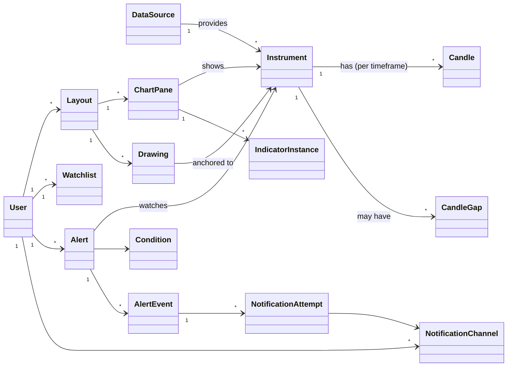

# 03 · Domain Model

| | |
|---|---|
| **Status** | Accepted |
| **Last reviewed** | 2026-11-13 |

This document defines the core concepts, their identities and the invariants every
module must preserve. Terms are also listed in the [glossary](glossary.md).

## 1. Concept map

## 2. Market data concepts

### 2.1 DataSource

A configured connection to one connector (for example "Binance (spot)"). It has
an ID (UUIDv7), connector type, display name, encrypted credentials, an enabled
flag, and status. **Invariant:** credentials are never returned by any API
(NFR-SEC-02).

### 2.2 Instrument

A tradable symbol on a specific source.

| Field | Example | Notes |
|---|---|---|
| `id` | `42` (int32, local) | Compact surrogate key used in the candle tables |
| `source_id` | UUID | |
| `symbol` | `BTCUSDT` | The source's native symbol |
| `display` | `BTC/USDT` | Normalised display name |
| `kind` | `crypto_spot` · `crypto_perp` · `equity` · `etf` · `fx` · `index` | |
| `base`, `quote` | `BTC`, `USDT` | Quote currency for equities (for example `USD`) |
| `tick_size` | `0.01` | Minimum price increment; drives display precision |
| `lot_size` | `0.00001` | Minimum quantity increment |
| `session` | `24x7` or a session spec reference | See §2.5 |
| `timezone` | `UTC` or `America/New_York` | IANA time-zone name |
| `status` | `active` · `halted` · `delisted` | |

The **instrument key** used in APIs and URLs is `<source-slug>:<symbol>`, for
example `binance:BTCUSDT`. It is stable and human-readable.

### 2.3 Timeframe

| Code | Duration | Bucket alignment |
|---|---|---|
| `1m` `3m` `5m` `15m` `30m` | N minutes | Epoch-aligned in UTC (`t - t mod N`) |
| `1h` `2h` `4h` `6h` `12h` | N hours | Epoch-aligned in UTC for 24x7 markets; session-aligned for session markets |
| `1D` | 1 day | **Daily boundary policy** of the instrument: UTC midnight (crypto default), session open (equities), or 17:00 America/New_York (FX convention) |
| `1W` | 1 week | Starts at the daily boundary on Monday (ISO 8601 week) |
| `1M` | 1 calendar month | Starts at the daily boundary on the 1st |

**Invariant:** a timeframe is either *native* (fetched from the source) or
*derived* (aggregated by Wickframe from a finer native timeframe). The derivation
chain is deterministic and documented per connector.

### 2.4 Candle

| Field | Type | Notes |
|---|---|---|
| `instrument_id` | int32 | |
| `tf` | small int enum | |
| `t` | int64 | **Open time**, Unix milliseconds, UTC |
| `o`, `h`, `l`, `c` | float64 | |
| `v` | float64 | Base-asset volume |
| `qv` | float64, nullable | Quote volume, if provided |
| `n` | int32, nullable | Trade count, if provided |
| `state` | `forming` · `closed` | |
| `rev` | int16 | Revision counter, incremented when a closed candle is corrected by the source |

**Invariants** (validated at ingestion; violations are rejected and counted in
`wickframe_candles_rejected_total{reason}`):

1. `l ≤ min(o, c)` and `h ≥ max(o, c)`; `l ≤ h`; `v ≥ 0`. All values are finite.
2. `t` is aligned to the timeframe's bucket boundary.
3. For each `(instrument, tf)` there is **at most one candle per `t`**; the primary
   key enforces this.
4. At most **one forming candle** per `(instrument, tf)`, and it is the latest one.
5. A closed candle is immutable, except for source corrections, which increment
   `rev` and emit a `candle.corrected` event so indicators and alerts can respond.
6. No interpolation: missing periods are either **empty** (no trades, a legitimate
   sparse bar) or recorded as a **gap** (see §2.6). They are never fabricated.

### 2.5 Session specification

Instruments in session-based markets reference a session spec: a time zone,
regular-hours windows per weekday, optional pre- and post-market windows, and a
holiday calendar. M1 ships `24x7` only. M2 adds US equities (NYSE/Nasdaq regular
and extended hours) with a maintained holiday table. Bucket alignment for
intraday timeframes in session markets starts at the session open.

### 2.6 CandleGap

`(instrument_id, tf, from, to, reason, status)`, where reason is
`disconnect`, `source_missing` or `import_hole`, and status is `pending`,
`backfilled` or `unrecoverable`. Gaps are shown on the chart (FR-DATA-08).

## 3. Workspace concepts

| Concept | Description | Key invariants |
|---|---|---|
| **Layout** | A named, saved chart workspace: grid arrangement, panes, styles, sync settings. Stored as a versioned JSON document (`schema_version`). | The document validates against the JSON Schema for its version. Older versions are migrated forward when read. |
| **ChartPane** | One chart inside a layout: instrument key, timeframe, chart type, scale mode, indicator instances. | Part of the layout document. |
| **IndicatorInstance** | Indicator id, parameters, style, target pane (overlay or separate). | Parameters validate against the indicator's parameter schema. |
| **Drawing** | Tool type, anchor points `(t, price)`, style, lock and visibility flags, and z-order. Stored as rows (not inside the layout JSON), so a single drawing can be edited without rewriting the layout. | Anchors are absolute time and price. They never store pixel or bar-index coordinates (FR-CHART-07). |
| **Watchlist** | An ordered list of instrument keys, optionally grouped into sections. | No duplicate instruments within a section. |

## 4. Alert concepts

| Concept | Description |
|---|---|
| **Alert** | Owner, instrument, timeframe, **condition**, trigger policy (`once`, `once_per_bar`, `once_per_bar_close`, `every_time` with re-arm interval), expiry, channels, message template, enabled flag. |
| **Condition** | Either a structured condition (operator, left operand, right operand; built by the UI) or an expression (expr-lang). **Both compile into the same internal program.** Operands are price fields, indicator outputs, constants or drawing references. |
| **AlertState** | Persisted evaluation state: last evaluated bar `t`, previous operand values (needed for crossings), armed or disarmed, and last fired time. |
| **AlertEvent** | One firing: time, bar `t`, operand values at firing, a `late` flag, and an idempotency key. |
| **NotificationChannel** | Kind (webhook, smtp, telegram, discord, ntfy) plus encrypted configuration. |
| **NotificationAttempt** | One delivery try: channel, status, HTTP status or error, latency, and the next retry time. |

**Crossing semantics** (precisely defined, because users depend on them):
`A crosses_above B` is true on an evaluation when `A_prev ≤ B_prev` and
`A_now > B_now`. Here *prev* is the value at the previous evaluation point *for
the same bar policy*: the previous closed bar for `once_per_bar_close`, or the
previous evaluated tick within the bar otherwise. `crosses_below` mirrors this.
`crosses` means either direction.

## 5. Identity concepts

| Concept | Description |
|---|---|
| **User** | ID, username, display name, role (`admin`, `member`), status. In personal mode a single implicit owner user exists. |
| **Credential** | Password hash (Argon2id with parameters), WebAuthn credentials, TOTP secret (encrypted), OIDC subject links. |
| **Session** | Server-side session record (ADR-0014). |
| **ApiToken** | ID, name, `SHA-256(secret)`, scopes, expiry, last used. |
| **AuditEntry** | Append-only: time, actor, action, target, IP address, user agent, outcome. |

## 6. Identifiers

| Entity | ID type | Rationale |
|---|---|---|
| Users, layouts, drawings, alerts, channels, sources, tokens | **UUIDv7** (RFC 9562) | Globally unique, time-ordered (good index locality), safe to expose |
| Instruments | int32 surrogate key, plus the public instrument key `source:symbol` | Keeps candle rows compact |
| Candles | Composite key `(instrument_id, tf, t)` | Natural key, no surrogate needed |
| Alert events, attempts | UUIDv7 | Also used as idempotency keys |
