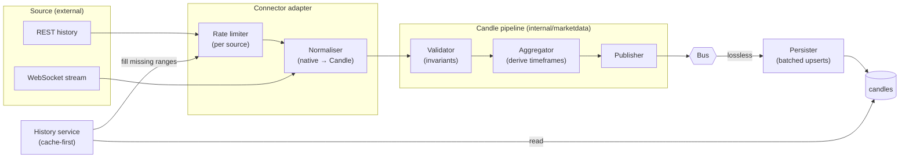

# 04 · Market Data: Connectors, Ingestion, Aggregation, Backfill

| | |
|---|---|
| **Status** | Accepted |
| **Last reviewed** | 2026-11-13 |
| **Requirements** | FR-DATA-01…15, NFR-PERF-03/07, NFR-REL-02 |
| **Decisions** | [ADR-0006](../adr/0006-bring-your-own-market-data.md), [ADR-0016](../adr/0016-connector-extension-model.md) |

## 1. Overview

## 2. Connector contract

Every connector implements `marketdata.Connector`
([components §4.1](02-components.md#41-market-data-connector-port)) and declares
`ConnectorInfo`:

| Field | Purpose |
|---|---|
| `id`, `name`, `version` | Identity, for example `binance` / "Binance" / `1.0.0` |
| `termsURL` | The source's API terms of use (shown in the UI; ADR-0006 rule 3) |
| `auth` | `none` · `api_key` · `api_key_secret` · `oauth` |
| `freshness` | `realtime` · `delayed(<duration>)` · `eod`; may depend on the user's plan |
| `nativeTimeframes` | Timeframes available from the source's history endpoint |
| `streamTimeframes` | Timeframes available as live kline streams (may differ from history) |
| `capabilities` | `trades`, `orderbook`, `extended_hours`, `corporate_actions`, `bulk_history` |
| `limits` | Documented request-weight budgets, max bars per request, max streams per connection, connection-attempt caps |
| `settingsSchema` | JSON Schema for user settings (for example a host variant, API key fields) |

**Responsibilities split.** Connectors translate protocol and format, and nothing
else. The core owns retries, reconnect supervision, validation, aggregation,
persistence and gap tracking. This keeps connectors small, and makes their
behaviour uniform and testable.

**Conformance kit** (`pkg/connectortest`): every connector must pass, against
recorded fixtures:

* Instrument parsing (precision, kinds).
* History pagination and boundary correctness (no overlap, no holes for liquid
  instruments).
* Forming-to-closed transitions.
* Correct handling of the source's error and rate-limit responses.
* Context cancellation (no goroutine leaks).
* Metadata completeness (ADR-0006 confirmation).

## 3. Built-in connector plan

Facts were checked against official documentation on 2026-11-13. Connectors must
re-verify them when implemented, because sources change their limits.

| Priority | Connector | Auth | History endpoint and limits | Real-time | Notes |
|---|---|---|---|---|---|
| **M1** | **Binance family**: spot, USD-M futures, Binance.US (host variants of one connector) | None for market data | Spot `GET /api/v3/klines`, max **1000** bars per request (verified live: requesting 1500 returns 1000); weight-based limits per IP, read live from `exchangeInfo.rateLimits` and `X-MBX-USED-WEIGHT-*` headers. A 429 must back off and honour `Retry-After`; ignoring it escalates to 418 IP bans. Market-data-only hosts: `data-api.binance.vision`, `data-stream.binance.vision`. | WS `@kline_<tf>`, `@trade`, `@ticker`. Connection lifetime max 24 h; the server pings every 20 s (spot) and expects a pong within 1 min; max 5 incoming messages per second; 1024 streams per connection; 300 connection attempts per 5 min per IP. USD-M: `fstream` with routed paths (`/public`, `/market`). | Binance is restricted for US users; Binance.US is the variant for them. Bulk historical ZIPs at `data.binance.vision` for fast backfill. |
| **M1** | **Kraken** | None | `GET /0/public/OHLC` returns only the **latest 720** bars (verified live: 720 plus the forming bar); deeper history via user-imported CSV | WS v2 `wss://ws.kraken.com/v2`, channel `ohlc`; idle timeout about 1 min (send ping); connection-attempt caps with temporary bans | Intervals: 1, 5, 15, 30, 60, 240, 1440, 10080, 21600 minutes. Bars exist only where trades occurred. |
| **M1** | **Coinbase Advanced Trade** | None for public endpoints | `.../market/products/{id}/candles`, max **350** bars, granularity up to 1 day | WS `advanced-trade-ws.coinbase.com`; `candles` channel is **5-minute only**, so other timeframes are built from `market_trades`; subscribe within 5 s; use the `heartbeats` channel; sequence numbers for gap detection | Market Data Terms restrict redistribution and display to third parties. Personal use within a self-hosted install is the intended mode (ADR-0006). The terms document predates the Advanced Trade rename, so it is flagged for re-review. |
| **M2** | **Alpaca** (US stocks and ETFs) | User's API key and secret | `GET /v2/stocks/bars`, up to 10,000 points per request with `page_token`; `adjustment` parameter; `feed` = `iex` on the free plan (the free plan cannot query the most recent 15 min of SIP data) | WS `stream.data.alpaca.markets/v2/iex` (free: 30 symbols, usually 1 connection); auth message within 10 s | The free plan is IEX-only, so it is labelled "IEX" in the UI, not "consolidated". Corrections channel available. |
| **M2** | **CSV / ZIP import** | — | User files: the documented Wickframe CSV, Binance bulk ZIP layout, Kraken OHLCVT CSV | — | Covers FX and deep history with no terms-of-use exposure. |
| M3 | OANDA (FX) | User's token | Max 5000 candles per request; daily alignment configurable (default 17:00 New York) | **Chunked HTTP stream** (NDJSON), not WebSocket; heartbeats every 5 s | |
| M3 | Bybit v5, OKX v5 | None | Bybit 1000 bars per request; OKX 300 bars per request, with `history-candles` for older data; OKX `1D` aligns to UTC+8 unless `1Dutc` is used | WS with client-sent pings | Geo restrictions apply to some users. |
| Later | Interactive Brokers (Web API) | User's session via a local gateway | Strict pacing rules | `smd` WS topic | Requires a funded account and market-data subscriptions. |
| Never bundled | Unofficial or scraped sources (for example Yahoo endpoints) | — | — | — | ADR-0006 rule 4: third-party plugins only. |

## 4. Rate limiting and connection management

* **Per-source limiter.** A weighted token bucket per `(source, host, limit class)`,
  configured from `ConnectorInfo.limits`, and **continuously corrected from
  response headers** where the source provides them (for example Binance's used-weight
  headers). Every request reserves its weight before sending.
* **Back-off on limit responses:** honour `Retry-After`; otherwise exponential
  backoff with full jitter (base 1 s, cap 5 min). A limit response pauses *all*
  requests to that host, not just the one that failed.
* **Connection budget:** connection attempts are themselves rate-limited per
  source (respecting caps such as Binance's 300 per 5 min and Kraken's attempt
  limits).
* **Stream multiplexing:** subscriptions are packed into the fewest connections
  allowed (for example up to 1024 streams per Binance connection), respecting
  per-connection message-rate limits for subscribe and unsubscribe bursts (batched
  and paced).
* **Proactive rotation:** connections with a maximum lifetime (Binance: 24 h) are
  replaced **before** expiry with make-before-break: open the new connection,
  subscribe, confirm the first message, then close the old one. This avoids a data
  hole.
* **Heartbeats:** each connector declares its keepalive rule (server ping and
  client pong, or client-sent ping). Missing heartbeats beyond 2× the interval mark
  the stream as dead → reconnect (NFR-REL-02: detection ≤ 30 s).

## 5. Candle pipeline

### 5.1 Normalise and validate

Connectors emit `CandleUpdate{instrument, tf, candle, state, sourceSeq}`. Prices
and volumes are parsed from the source's decimal strings with
`strconv.ParseFloat(s, 64)`. The validator enforces the
[candle invariants](03-domain-model.md#24-candle) and rejects invalid updates,
logging and counting them.

### 5.2 Aggregation (derived timeframes)

For timeframes that are not native, the aggregator builds candles from a finer
native series. The preference order is: native kline stream → finer native kline
→ trades.

| Rule | Detail |
|---|---|
| Open | Open of the first constituent bar |
| High / Low | Max / min of the constituents |
| Close | Close of the last constituent |
| Volume | Sum |
| Boundaries | Per the timeframe alignment and the instrument's daily boundary policy ([domain §2.3](03-domain-model.md#23-timeframe)) |
| Forming → closed | A derived bar closes when the bucket end passes **and** the last constituent is closed. A grace window (default 2 s, per connector) absorbs late source messages. |
| From trades | Bucket by the **exchange trade timestamp**, never by arrival time. |

The aggregator is a pure, deterministic function, tested with property-based tests
(for example: aggregating 1m to 5m to 15m equals aggregating 1m to 15m directly).

### 5.3 Publishing

Validated candles are published on the bus under the topic
`candle.<instrument_id>.<tf>` ([real-time](05-realtime.md)). Closed and corrected
candles are always published; forming updates may be conflated for UI subscribers.

### 5.4 Persistence

The persister holds a lossless subscription and **batch-upserts** (up to 500 rows
or 250 ms, whichever comes first) using `INSERT … ON CONFLICT (instrument_id, tf, t)
DO UPDATE`. Only closed bars are persisted by default. The forming bar lives in
memory and is re-derived after a restart from the source plus a REST
re-fetch of the last N bars.

## 6. History loading (cache-first)

When a chart requests `(instrument, tf, from, to)`:

1. **Plan:** compute the requested range. Query the local **coverage index**
   (contiguous ranges known to be complete for this series) to find missing
   sub-ranges.
2. **Serve what is local** immediately when the request allows partial results,
   so the chart renders before the network returns.
3. **Fetch missing ranges** from the source (natively, or by fetching the finer
   timeframe and aggregating), paginated, oldest first, through the limiter.
   Concurrent requests for the same range are **de-duplicated** (single-flight).
4. **Upsert and extend coverage.** Sparse periods with no bars from the source are
   recorded as covered (empty), not as gaps.
5. **Return** the merged result.

Depth limits: a source's history depth (for example Kraken's 720 bars) is reported
to the UI, which shows "No more history from this source — import CSV for older
data" instead of silently stopping.

## 7. Gap detection and backfill

| Trigger | Action |
|---|---|
| Stream reconnect after an outage | Record a `disconnect` gap from the last closed bar to the reconnect time. REST-fetch that range, upsert, publish the recovered closed bars **in order** (the alert engine evaluates them and marks resulting events `late`, FR-ALERT-10), then mark the gap `backfilled`. |
| Sequence discontinuity (sources with sequence numbers, for example Coinbase) | Same as above, for the affected window. |
| Source cannot provide the range | Mark the gap `unrecoverable` and show it on the chart (FR-DATA-08). |
| Scheduled audit (every 6 h) | Scan recent coverage for unexpected holes on liquid instruments, and backfill them. |

## 8. Instrument catalogue

* Loaded per source on enable, and refreshed daily (with jitter). Changes are
  recorded as differences (new, delisted, precision changed).
* Precision (tick and lot size) is read from source metadata (for example Binance
  `exchangeInfo` filters, OKX `tickSz`).
* Instrument search is served locally (an indexed prefix search over symbol and
  display name), never by calling the source on every keystroke.

## 9. Corporate actions (M3)

Raw bars are stored as received, together with a `corporate_actions` table
(splits, dividends). Adjustment (`raw`, `split`, `split_div`) is applied **when
bars are read**, so changing the setting needs no re-download. Sources default
differently (for example Alpaca returns raw, Polygon/Massive returns adjusted), so
connectors must request **raw** data and the corporate actions explicitly.

## 10. Metrics (subset)

| Metric | Type | Labels |
|---|---|---|
| `wickframe_source_up` | gauge | `source` |
| `wickframe_source_messages_total` | counter | `source`, `kind` |
| `wickframe_source_reconnects_total` | counter | `source`, `reason` |
| `wickframe_source_request_duration_seconds` | histogram | `source`, `endpoint` |
| `wickframe_source_ratelimit_waits_total` | counter | `source` |
| `wickframe_candles_rejected_total` | counter | `source`, `reason` |
| `wickframe_candle_ingest_lag_seconds` | histogram | `source` (exchange event time → published) |
| `wickframe_gaps_open` | gauge | `source`, `status` |

Labels never include instrument symbols, to bound cardinality
([observability](12-observability.md)).
