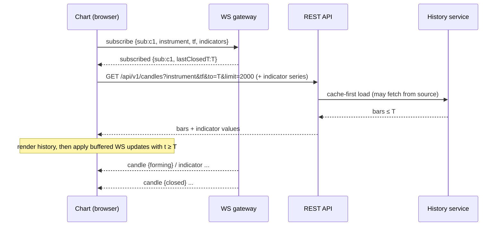

# 05 · Real-time: Event Hub and WebSocket Protocol

| | |
|---|---|
| **Status** | Accepted |
| **Last reviewed** | 2026-11-13 |
| **Requirements** | FR-DATA-06, FR-API-02, NFR-PERF-03/04, NFR-REL-05 |
| **Decisions** | [ADR-0008](../adr/0008-realtime-transport.md), [ADR-0010](../adr/0010-single-indicator-engine.md) |

## 1. Internal event hub (`internal/bus`)

### 1.1 Topics

| Topic | Payload | Producers | Consumers |
|---|---|---|---|
| `candle.<instrument_id>.<tf>` | `CandleEvent{candle, state, rev}` | candle pipeline | persister (lossless), indicator cache (lossless), alert engine (lossless), WS gateway (conflating) |
| `indicator.<series_key>` | `IndicatorEvent{t, outputs, state}` | indicator cache | WS gateway (conflating), alert engine (in-process call) |
| `source.status.<source_id>` | `SourceStatus` | connector supervisor | WS gateway, UI status, alert engine (marks alerts degraded) |
| `alert.fired` | `AlertEvent` | alert engine | notify outbox (written transactionally, not via bus), WS gateway (to the owner) |

`series_key` = hash of `(instrument_id, tf, indicator_id, canonical params)`.

### 1.2 Delivery classes

| Class | Used by | Queue | When full |
|---|---|---|---|
| **Lossless** | persister, indicator cache, alert engine | Bounded (default 4,096 events) | The publisher **blocks** (back-pressure reaches the connector read loop). If blocked > 5 s: error log, `wickframe_bus_stall_seconds` increments, the consumer is flagged for **resync from storage**. Never a silent drop. |
| **Conflating** | WS client sessions | Bounded map keyed by topic. The forming-bar slot is overwritten by newer updates; closed-bar events are appended to a small FIFO (default 256). | If the FIFO overflows: the session is marked *lagging*. If lagging > 10 s → disconnect with close code **1013**; the client resyncs on reconnect. |

Publishing to conflating subscribers is **non-blocking**, so a slow browser can
never slow ingestion or alerts (NFR-REL-05).

### 1.3 Ordering

Within a topic, events are delivered in publish order. There is no ordering
guarantee across topics. Each `CandleEvent` carries `(t, state, rev)`, so
consumers can discard stale updates: an update is stale if its `t` is older than
the last closed bar, or it has the same `t` with a lower `rev`.

## 2. WebSocket protocol `wickframe.v1`

### 2.1 Connection

* Endpoint: `GET /api/v1/ws`, with sub-protocol `Sec-WebSocket-Protocol: wickframe.v1`.
  The server rejects unknown sub-protocols.
* **Authentication:**
  * Browsers use the session cookie. The server validates the **`Origin`** header
    against the configured public origin (cross-site WebSocket hijacking
    protection).
  * Programmatic clients send `Authorization: Bearer <token>` on the upgrade
    request.
  * Tokens are **never** accepted in query strings, because URLs end up in logs.
* Frames are JSON text frames (encoded with `encoding/json/v2`, GA in Go 1.27).
  Maximum inbound message size is 64 KiB. permessage-deflate is **off** by default
  (small, frequent messages; CPU cost); configurable.
* Keepalive: the server sends WebSocket ping frames every 20 s; a missing pong
  within 40 s closes the connection.

### 2.2 Envelope

```jsonc
// every message
{ "type": "<message type>", "id": "<client correlation id, optional>", "...": "..." }
```

### 2.3 Client → server

| `type` | Fields | Description |
|---|---|---|
| `subscribe` | `sub` (client-chosen subscription id), `channel` (`candles`), `instrument` (`binance:BTCUSDT`), `tf` (`1m`…`1M`), `indicators` (optional list of `{key, id, params}`) | Starts streaming. The server first replies `subscribed`, then sends updates. |
| `unsubscribe` | `sub` | Stops a subscription. |
| `subscribe` | `sub`, `channel: "status"` | Source and system status updates. |
| `subscribe` | `sub`, `channel: "alerts"` | The owner's alert firings in real time. |
| `ping` | — | Application-level ping (for environments that hide WS control frames). |

Limits: at most 200 active subscriptions per connection, and 20 subscribe or
unsubscribe messages per second (token bucket). Violations → `error` with
`code: "rate_limited"`.

### 2.4 Server → client

| `type` | Fields | Description |
|---|---|---|
| `welcome` | `protocol`, `serverVersion`, `sessionId`, `limits` | First message after connect. |
| `subscribed` | `sub`, `seq: 0`, `lastClosedT` | Acknowledges a subscription. **History is not sent over WS**; the client fetches it over REST up to `lastClosedT`, then applies WS updates (see §3). |
| `candle` | `sub`, `seq`, `t`, `o`, `h`, `l`, `c`, `v`, `state` (`forming` or `closed`), `rev` | Candle update. |
| `indicator` | `sub`, `seq`, `key`, `t`, `values` (`{output: number or null}`), `state` | Indicator values for the same bar, sent right after the related `candle`. |
| `status` | `sub`, `source`, `state` (`connected`, `degraded`, `delayed`, `disconnected`), `detail` | Source status. |
| `alert` | `sub`, `event` | Alert firing (owner only). |
| `resync` | `sub`, `reason` | The client must refetch from REST and resubscribe (for example after a correction storm or lag). |
| `error` | `id` or `sub`, `code`, `message` | Problem Details-style codes: `invalid_message`, `unknown_instrument`, `forbidden`, `rate_limited`, `limit_exceeded`. |
| `pong` | — | Reply to `ping`. |

Example:

```json
{"type":"candle","sub":"c1","seq":418,"t":1794526260000,
 "o":71407.85,"h":71447.23,"l":71407.85,"c":71412.93,"v":4.08906,"state":"forming","rev":0}
```

### 2.5 Sequencing and resync

* `seq` increases by 1 per message **per subscription**. Conflation skips
  *forming* updates but never closed ones, so `seq` gaps are expected and allowed
  for `forming` messages only.
* The client tracks `lastClosedT`. If it receives a closed candle whose `t` is more
  than one bar after its `lastClosedT`, it fetches the missing range over REST.
* After a reconnect, the client resubscribes and backfills via REST from its
  `lastClosedT`. The server keeps no per-client replay buffer, which keeps the
  server stateless across reconnects.

### 2.6 Close codes

| Code | Meaning in Wickframe |
|---|---|
| 1000 | Normal closure (client unsubscribe-all, logout) |
| 1001 | Server shutting down; the client should reconnect with backoff |
| 1008 | Policy violation (auth failure, origin mismatch, protocol abuse) |
| 1011 | Unexpected server error |
| 1013 | Try again later (lagging client disconnected, server overloaded) |

Clients reconnect with exponential backoff and full jitter (0.5 s → 30 s cap),
except after 1008, where they must re-authenticate first.

### 2.7 Versioning

The sub-protocol name carries the major version. Additive changes (new message
types or fields) are allowed within `v1`; clients must ignore unknown fields and
types. Breaking changes require `wickframe.v2`, served alongside `v1` for at least
one minor release (NFR-MAINT-05).

## 3. Client data-loading sequence



The client **buffers** WS updates received before the REST response arrives, then
applies them, discarding any with `t` before the last REST bar. This avoids the
classic "missing bar between history and live" race.

## 4. Capacity model (reference server)

| Quantity | Target | Basis |
|---|---|---|
| WS clients | ≥ 200 | NFR-PERF-04 |
| Subscriptions per client | ≤ 200 | Protocol limit |
| Forming updates per instrument | ≤ 10 per second after conflation (configurable throttle) | Smooth rendering; bandwidth |
| Outbound per client (worst case, 20 active charts) | ≈ 200 msg/s × ~200 B ≈ 40 KB/s | Fine on LAN and typical WAN |

Load-test scenarios are defined in [quality](14-quality.md).
