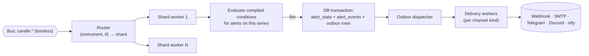

# 07 · Alert Engine and Notifications

| | |
|---|---|
| **Status** | Accepted |
| **Last reviewed** | 2026-11-13 |
| **Requirements** | FR-ALERT-01…11, FR-API-04, NFR-PERF-05, NFR-REL-03 |
| **Decisions** | [ADR-0010](../adr/0010-single-indicator-engine.md), [ADR-0011](../adr/0011-scripting-engine.md), [ADR-0008](../adr/0008-realtime-transport.md) |

## 1. Guarantees

| # | Guarantee |
|---|---|
| A1 | In server mode, every enabled alert is evaluated on every relevant update, whether or not any browser is connected. |
| A2 | An alert fires **at most once per firing opportunity** (as defined by its trigger policy), including across restarts. No duplicate firings. |
| A3 | Every firing is **durably recorded before any notification is attempted** (transactional outbox). |
| A4 | Notifications are delivered **at least once**, with a stable idempotency key per (event, channel) so receivers can deduplicate. |
| A5 | Bars recovered by backfill after an outage are evaluated in order. Resulting firings are marked `late: true` with the original bar time. |
| A6 | Every failure (compile error, source down, delivery failure) is visible to the alert's owner in the UI and in the alert history. Nothing fails silently. |

## 2. Evaluation pipeline

* **Sharding:** alerts are partitioned by `hash(instrument_id, tf) mod N` (default
  N = GOMAXPROCS). One goroutine per shard processes events in order, so there is
  no locking on alert state within a series, and ordering is deterministic.
* **Inputs per evaluation:** the candle event plus the indicator outputs required
  by the alerts on that series. These come from the shared indicator cache in the
  same process, so values are identical to what charts show (ADR-0010).
* **Compiled conditions:** structured conditions and expressions both compile to
  an `expr` program at save time. Compile errors are rejected by the API with field
  details. Programs are cached by alert ID and version.

### 2.1 Trigger policies

| Policy | Evaluated on | Fires | Re-arms |
|---|---|---|---|
| `once` | every update | first time the condition is true | never (the alert disables itself) |
| `once_per_bar` | every update (forming and closed) | first true within a bar | at the next bar |
| `once_per_bar_close` | closed bars only | when true at bar close | each closed bar |
| `every_time` | every update | each time it becomes true (edge-triggered) | after `rearm_interval` (minimum 10 s) and the condition going false |

Crossing semantics are defined in the
[domain model](03-domain-model.md#4-alert-concepts).

### 2.2 State persistence

`alert_state` stores, per alert: `last_eval_t`, `last_eval_rev`, the previous
operand values needed for crossings, `armed`, `last_fired_t`, and a
`fire_count_in_bar` marker.

* State updates and firings are written **in the same transaction**. After a
  crash, the engine reloads state and continues. Events at or before `last_eval_t`
  and `last_eval_rev` are ignored, which makes processing **idempotent** (A2).
* Forming-bar intermediate state is checkpointed at most every 5 s, or on firing.
  Crash recovery may re-evaluate a few forming ticks, which cannot double-fire
  because firing is recorded atomically with state.

### 2.3 Degraded inputs

* If the source is disconnected, the alert shows `degraded` (from
  `source.status`). Evaluation resumes on recovered bars (A5).
* If a required indicator is still warming up, the condition evaluates to *not
  ready* (never true).
* If an instrument is delisted, the alert is disabled and its owner notified.

## 3. Transactional outbox

Firing writes, in one transaction:

1. An `alert_events` row (ID UUIDv7; fields: alert, bar `t`, operand values,
   `late`).
2. One `notification_outbox` row per configured channel:
   `(id, event_id, channel_id, idempotency_key = event_id:channel_id,
   status = pending, attempts = 0, next_attempt_at = now)`.

The **dispatcher** polls for due outbox rows (PostgreSQL: `SELECT … FOR UPDATE
SKIP LOCKED`; SQLite: the single writer claims rows in a transaction) and hands
them to delivery workers. This decouples alert evaluation from slow or failing
external services.

### 3.1 Retry policy

| Attempt | Delay before attempt | Cumulative (approx.) |
|---|---|---|
| 1 | immediate | 0 |
| 2 | 10 s | 10 s |
| 3 | 30 s | 40 s |
| 4 | 2 min | 3 min |
| 5 | 10 min | 13 min |
| 6 | 30 min | 43 min |
| 7 | 1 h | 1 h 43 min |
| 8 | 3 h | 4 h 43 min |
| 9 | 6 h | 10 h 43 min |

Each delay has ±20% jitter. A `Retry-After` header from the receiver overrides the
schedule (capped at 6 h). After attempt 9 the row becomes `failed` (dead letter)
and is shown in the UI with a "retry now" action. `4xx` responses other than
`408` and `429` are **not retried**: they are configuration errors, and the
channel is flagged for the user to fix.

## 4. Notification channels

| Kind | Transport | Configuration (encrypted at rest) | Notes |
|---|---|---|---|
| `webhook` | HTTPS POST, JSON | URL, signing secret, custom headers | Signed per §6. SSRF protection per §7. |
| `email` | SMTP | Host, port, username, password, from, to | STARTTLS or implicit TLS required by default; plaintext only with an explicit insecure flag. |
| `telegram` | Telegram Bot API `sendMessage` | Bot token, chat ID | MarkdownV2 escaping of all variable content. |
| `discord` | Discord webhook URL | Webhook URL | Embeds; mentions disabled (`allowed_mentions: {parse: []}`). |
| `ntfy` | HTTP POST to an ntfy server | Server URL, topic, optional token | Priority and tags mapped from alert severity. |

Adding a channel = implementing `notify.Notifier`
([components §4.3](02-components.md#43-alert-and-notify-services)), plus
conformance tests with an HTTP test server.

## 5. Message templates

* Templates use Go `text/template` with a fixed data model:
  `{{.Alert.Name}}`, `{{.Instrument}}`, `{{.Timeframe}}`, `{{.Price}}`,
  `{{.Values.rsi}}`, `{{.Time}}`, `{{.Late}}`, `{{.URL}}`.
* **Only whitelisted functions** are available (formatting numbers and times).
  Templates have no access to the filesystem, environment or network. Execution
  time is capped at 100 ms, and output at 4 KiB.
* **Escaping is per channel**: HTML for email bodies, MarkdownV2 for Telegram, JSON
  encoding for webhooks. Escaping is applied to the *data*, not the template, so
  user-controlled names can't inject markup.

## 6. Webhook signing

Webhook deliveries follow the **Standard Webhooks** convention, so receivers can
use existing verification libraries:

| Header | Value |
|---|---|
| `webhook-id` | The outbox idempotency key (stable across retries) |
| `webhook-timestamp` | Unix seconds at send time |
| `webhook-signature` | `v1,<base64(HMAC-SHA256(secret, "{id}.{timestamp}.{body}"))>`. Several space-separated values during secret rotation. |

* Secrets are generated by Wickframe (32 random bytes, shown once as `whsec_…`)
  and can be rotated with an overlap period.
* Receivers should reject timestamps more than 5 minutes off and deduplicate on
  `webhook-id` (documented, with examples in Go, Python and JavaScript).
* Body schema: a versioned JSON event, `type: "alert.fired"`, `version: 1`,
  documented in the API reference.

## 7. Outbound request safety (SSRF)

User-supplied URLs (webhooks, ntfy, OIDC discovery) are fetched by the server. In
**server mode**:

* Resolve DNS and **block** loopback, link-local (including cloud metadata
  `169.254.169.254`), private (RFC 1918, `fc00::/7`) and other non-public ranges,
  **after** resolution, on every connection attempt. This is done in a custom
  dialer, which also defeats DNS rebinding.
* Allow `https` only by default; `http` requires an explicit per-channel flag.
* Do not follow redirects across hosts; at most 3 redirects.
* Timeouts: connect 5 s, total 15 s. Response body read capped at 64 KiB.
* An operator allow-list (`notify.allowPrivateHosts`) permits specific internal
  targets (for example a LAN ntfy server).

In personal mode the block-list is relaxed for private ranges, because a local
user targeting their own LAN is legitimate, but cloud-metadata addresses remain
blocked.

## 8. Metrics

| Metric | Type | Labels |
|---|---|---|
| `wickframe_alerts_active` | gauge | — |
| `wickframe_alert_eval_duration_seconds` | histogram | — |
| `wickframe_alert_eval_lag_seconds` | histogram | — (update publish → evaluated) |
| `wickframe_alerts_fired_total` | counter | `policy`, `late` |
| `wickframe_notifications_total` | counter | `kind`, `result` (`ok`, `retry`, `failed`) |
| `wickframe_notification_delivery_seconds` | histogram | `kind` |
| `wickframe_outbox_pending` | gauge | `kind` |
