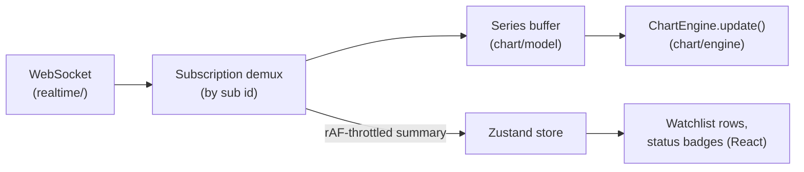

# 10 · Frontend Architecture

| | |
|---|---|
| **Status** | Accepted |
| **Last reviewed** | 2026-11-13 |
| **Requirements** | FR-CHART-*, NFR-PERF-01…03, NFR-UX-01…04 |
| **Decisions** | [ADR-0005](../adr/0005-chart-engine.md), [ADR-0012](../adr/0012-frontend-stack.md), [ADR-0010](../adr/0010-single-indicator-engine.md) |

## 1. Shape

A client-rendered single-page application (SPA), built by Vite into static
assets, embedded in the Go binary (`web/dist` via `embed.FS`) and served with
long-lived cache headers for hashed assets and `no-cache` for `index.html`. There
is no Node.js process at runtime.

## 2. Source layout (`web/`)

```text
web/
├── index.html
├── package.json            # packageManager: pnpm@12.x, scripts
├── biome.json  tsconfig.json  vite.config.ts  playwright.config.ts
├── public/                 # static files copied as-is (icons, manifest)
└── src/
    ├── main.tsx            # bootstrap: providers, router, i18n
    ├── app/                # routes (TanStack Router file routes), layouts, error boundaries
    ├── features/           # vertical feature slices — UI + hooks + state per feature
    │   ├── chart/          # chart screen: toolbar, panes, legends, context menus
    │   ├── drawings/       # drawing toolbar & object tree (uses chart/drawings core)
    │   ├── indicators/     # indicator picker & settings (descriptor-driven forms)
    │   ├── watchlists/
    │   ├── alerts/         # alert editor, history, delivery status
    │   ├── sources/        # data source setup & status
    │   ├── settings/
    │   └── auth/
    ├── chart/              # framework-agnostic chart core (no React imports)
    │   ├── engine/         # ChartEngine interface + Lightweight Charts adapter (ONLY place importing it)
    │   ├── drawings/       # drawing tools: state machines, hit-testing, handles, serialisation
    │   └── model/          # series buffers, time/price math, tick-size formatting
    ├── realtime/           # WebSocket client: protocol v1, reconnect, subscriptions, buffering
    ├── api/                # generated OpenAPI types + thin fetch client + TanStack Query hooks
    ├── ui/                 # design system: shadcn/ui components (Base UI), tokens
    ├── i18n/               # i18next setup + locales/en/*.json
    ├── lib/                # small shared utilities (no feature logic)
    └── test/               # test utilities, MSW handlers, fixtures
```

**Import rules** (Biome `noRestrictedImports` plus a dependency-cruiser-style
check in CI):

* `chart/*` and `realtime/*` never import React or `features/*`. They are plain
  TypeScript, unit-testable without a DOM where possible.
* `features/*` may import `chart`, `realtime`, `api`, `ui`, `lib`, `i18n`, but
  **not other features' internals**. Each feature exposes an `index.ts`.
* Only `chart/engine/` imports `lightweight-charts`.

## 3. State model

| State | Lives in | Why |
|---|---|---|
| Chart state that belongs in the URL: layout ID, active instrument, timeframe | **Router search params** (typed) | Shareable, bookmarkable, back/forward works |
| Server data: layouts, alerts, watchlists, descriptors, instrument search | **TanStack Query** cache | Caching, retries, invalidation, optimistic updates |
| Live market data: candles, indicator values | **Chart core buffers** (outside React) | Ticks must not cause React renders |
| Low-rate live summaries: last price per watchlist row, connection status | **Zustand vanilla store**, updated at most once per animation frame | Cheap selective subscriptions |
| Ephemeral UI: open dialogs, active drawing tool | Component state or a small Zustand slice | Local |

### 3.1 Real-time data path (hot path)



* Incoming messages are parsed once, routed by `sub`, applied to the series
  buffer, and pushed to the engine with `update()` (the forming bar) or `append`
  (a new bar).
* The **REST/WS stitching** algorithm from
  [real-time §3](05-realtime.md#3-client-data-loading-sequence) lives in
  `realtime/`, with unit tests for every race.
* **Performance assertion:** E2E tests use the React Profiler API to assert that
  zero React commits are caused by candle ticks on the chart route.

## 4. Drawing tools subsystem (`chart/drawings`)

* Each tool is a **finite state machine** (idle → placing anchor 1 … → complete
  → selected → dragging handle), independent of the renderer.
* Geometry is computed in **(time, price)** space and converted to pixels through
  the engine's coordinate API at render time. Snapping ("magnet") goes to the
  nearest O/H/L/C within a pixel radius.
* Rendering uses Lightweight Charts **series primitives**. Hit-testing uses
  per-tool distance functions with a tolerance in CSS pixels.
* Commands (`create`, `move`, `restyle`, `delete`) go through an **undo/redo
  stack**, and are persisted with debounced batch saves
  (`POST /drawings:batchUpdate`), using optimistic updates with version checks.
* Serialised format: `{tool, anchors: [{t, p}], style, v: <tool schema version>}`.
  It is engine-independent (ADR-0005).

## 5. Routing (initial)

| Route | Screen |
|---|---|
| `/` | Redirect to the last layout, or the onboarding chart |
| `/chart/$layoutId?symbol=&tf=` | Main charting workspace |
| `/alerts` · `/alerts/$id` | Alert list and editor, history |
| `/watchlists` | Watchlist management (also a chart side panel) |
| `/settings/*` | Data sources, notification channels, account, API tokens, appearance |
| `/admin/*` | Users, system status (server mode, admin role) |
| `/login` | Server mode authentication |

## 6. Design system, accessibility, i18n

* **Tokens:** CSS custom properties (color, spacing, radius, typography, chart
  palette) defined once, with light and dark themes switched by a `data-theme`
  attribute and following `prefers-color-scheme` by default. The chart engine
  reads the same tokens, so the chart and UI themes always match.
* **Components:** shadcn/ui on Base UI. Accessible primitives (focus management,
  ARIA) come built in. Custom components must pass axe-core checks in Playwright.
* **Keyboard:** documented shortcuts (symbol search `/`, timeframe keys, drawing
  tool keys, `Esc` to cancel, `Delete` to remove the selection), all remappable
  later. A visible focus ring is required.
* **Chart accessibility:** an accessible data-table view of the visible bars and
  indicator values (toggle), a keyboard-driven crosshair, and live-region
  announcements for alert firings (NFR-UX-02).
* **i18n:** all strings go through i18next keys from M1. Number, date and currency
  formatting uses `Intl` with the user's locale. Prices use instrument
  tick-size precision.

## 7. Performance budgets

| Budget | Target | Enforced by |
|---|---|---|
| Initial JS for the chart route | ≤ 300 KB min+gzip | `vite build` size check in CI |
| Time to first candle paint (5k bars, 3 indicators, LAN) | ≤ 1.0 s p95 | Playwright performance test (NFR-PERF-01) |
| Pan/zoom frame rate (20k bars, 5 indicators) | ≥ 55 fps | Playwright trace analysis (NFR-PERF-02) |
| Memory after 1 h of streaming, 4-chart layout | No unbounded growth (< 10% after warm-up) | Soak test (nightly) |

Techniques: route-level code splitting; lazy-loaded heavy features (alert
editor, settings); series buffers in typed arrays (`Float64Array`) for large
histories; `requestAnimationFrame` batching.

## 8. Security (client side)

* **Content Security Policy** served by the backend: `default-src 'self'`;
  `script-src 'self'` (no inline scripts, no `eval`); `connect-src 'self'` (plus
  `wss:` on the same origin); `img-src 'self' data:`; `frame-ancestors 'none'`.
  Vite's build is configured to emit no inline scripts.
* No `dangerouslySetInnerHTML`, enforced by a lint rule. User-provided strings
  (layout names, alert messages) are rendered as text only.
* No tokens in `localStorage`. Browser auth uses HttpOnly cookies only.
* Dependencies are checked by `pnpm audit` and Renovate
  ([ADR-0015](../adr/0015-supply-chain-and-release.md)).

## 9. Testing (summary; full strategy in [quality](14-quality.md))

| Layer | Tool | Focus |
|---|---|---|
| Unit | Vitest | `chart/model`, `chart/drawings` geometry and state machines, `realtime` stitching and reconnect |
| Component | Vitest + Testing Library | Forms (descriptor-driven indicator settings, alert editor) |
| API mocking | MSW | Deterministic UI tests without a backend |
| E2E | Playwright (Chromium, Firefox, WebKit) | Critical journeys against a real backend with a fake connector |
| Visual | Playwright screenshots | Chart rendering, drawings, themes (pixel-diff thresholds) |
| Accessibility | axe-core in Playwright | WCAG 2.2 AA rules on every route |
