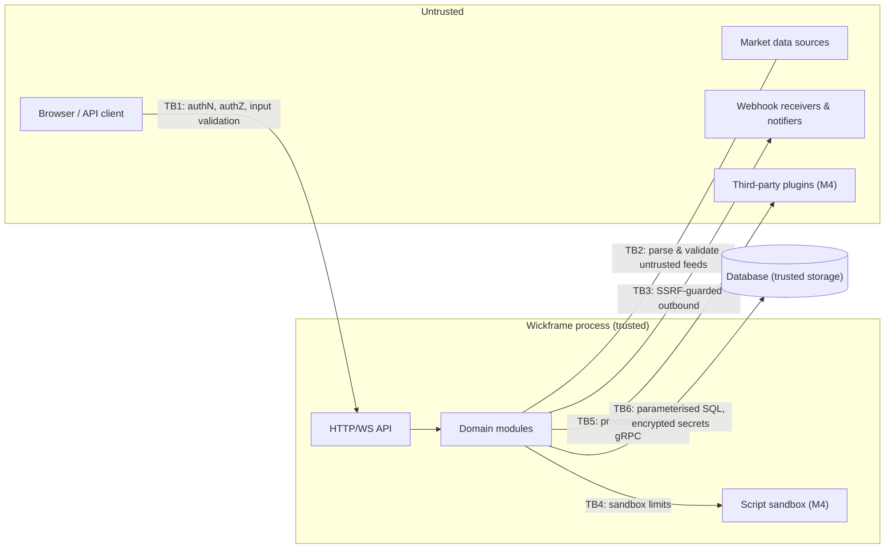

# 11 · Security Architecture and Threat Model

| | |
|---|---|
| **Status** | Accepted (living document — update when a trust boundary changes) |
| **Last reviewed** | 2026-11-13 |
| **Requirements** | NFR-SEC-01…06, FR-USER-*, FR-ALERT-07 |
| **Decisions** | [ADR-0014](../adr/0014-authentication.md), [ADR-0015](../adr/0015-supply-chain-and-release.md), [ADR-0011](../adr/0011-scripting-engine.md), [ADR-0016](../adr/0016-connector-extension-model.md) |

## 1. Assets

| Asset | Why it matters | Sensitivity |
|---|---|---|
| Data-source credentials (broker or vendor API keys) | Some keys may have **trading or withdrawal permissions** if users misconfigure them. | Critical |
| Notification secrets (bot tokens, SMTP passwords, webhook secrets) | Impersonation, spam, pivoting into user systems | High |
| User accounts and sessions, API tokens | Account takeover | High |
| Watchlists, alerts, layouts | Reveal trading intent and positions | Medium–High (privacy) |
| Integrity of alerts and webhooks | A forged webhook could trigger a user's trading bot | High |
| Release artifacts | A supply-chain compromise affects all users | Critical |
| Market data | Licensed content; must not be redistributed (ADR-0006) | Medium (legal) |

## 2. Trust boundaries

## 3. STRIDE threat analysis (key threats and controls)

| ID | Threat | Category | Boundary | Controls |
|---|---|---|---|---|
| T1 | Personal-mode server exposed on the LAN or internet with no auth | Elevation of privilege | TB1 | Refuse non-loopback bind unless auth is enabled (FR-USER-01); desktop per-launch token; startup warning banner. |
| T2 | Credential stuffing / brute force | Spoofing | TB1 | Argon2id; per-account and per-IP rate limits with backoff; optional TOTP and passkeys; audit log; generic error messages. |
| T3 | Session hijacking or fixation | Spoofing | TB1 | `__Host-` HttpOnly Secure SameSite cookie; rotation on login; idle and absolute timeouts; logout invalidates server-side. |
| T4 | CSRF and cross-site WebSocket hijacking | Tampering | TB1 | `http.CrossOriginProtection`; `Origin` check on WS upgrade; SameSite cookies. |
| T5 | IDOR: reading or editing another user's layouts or alerts | Information disclosure | TB1 | Owner checks in the service layer; `404` for invisible resources; authorisation tests for every endpoint (generated from OpenAPI). |
| T6 | XSS via user-controlled names or messages | Tampering | TB1 | React text rendering; no `dangerouslySetInnerHTML`; strict CSP without `unsafe-inline`; per-channel escaping in notifications. |
| T7 | Injection (SQL) | Tampering | TB6 | sqlc-generated parameterised queries only; no string-built SQL (lint rule). |
| T8 | Malicious or malformed market-data feed (huge messages, NaN, decompression bombs) | Denial of service / tampering | TB2 | Message size limits; streaming JSON decoding with limits; candle validation invariants; per-source panic isolation. |
| T9 | SSRF via webhook, ntfy or OIDC URLs to internal services or cloud metadata | Information disclosure | TB3 | Post-resolution IP block-list in a custom dialer (defeats DNS rebinding); https-only default; redirect limits ([alerts §7](07-alerts.md#7-outbound-request-safety-ssrf)). |
| T10 | Forged or replayed webhooks to a user's bot | Spoofing | TB3 | Standard Webhooks HMAC signatures with timestamps and IDs; documented verification. |
| T11 | Secrets leaked via API responses, logs or backups | Information disclosure | all | Write-only secret fields; encryption at rest (§5); log redaction (§7); backups contain ciphertext only. |
| T12 | Malicious user script (M4) escaping or exhausting resources | Elevation / DoS | TB4 | No ambient capabilities; step, time and memory limits; separate worker pool; separate process on multi-tenant servers (ADR-0011). |
| T13 | Malicious third-party plugin (M4) | Elevation | TB5 | Explicit operator enablement with a pinned checksum; separate process; least-privilege gRPC surface (plugins never receive DB access or other sources' secrets). |
| T14 | Compromised dependency or build pipeline | Tampering | supply chain | Pinned actions, SBOMs, govulncheck, cosign signatures, provenance, Scorecard (ADR-0015). |
| T15 | Template injection in notification messages | Tampering | TB3 | `text/template` with whitelisted functions, time and size caps; data escaped per channel. |
| T16 | Resource exhaustion via many WS subscriptions or heavy history requests | DoS | TB1 | Subscription caps, per-principal rate limits, request size and range limits, the source limiter. |
| T17 | Repudiation of security-relevant actions | Repudiation | TB1 | Append-only audit log (FR-USER-07) with actor, IP, user agent and outcome. |

## 4. Authentication and authorisation

Specified in [ADR-0014](../adr/0014-authentication.md) and the
[API conventions §6](09-api.md#6-authentication-and-authorisation). Summary:
server-side sessions, Argon2id passwords, scoped opaque API tokens (hashed),
optional OIDC, passkeys and TOTP, roles plus ownership checks in services, deny by
default.

## 5. Secrets at rest

* **Algorithm:** XChaCha20-Poly1305 (`golang.org/x/crypto/chacha20poly1305`).
  Its 192-bit random nonces are safe to generate randomly at any volume.
* **Key hierarchy:** a 256-bit **master key** supplied by:
  1. `WICKFRAME_SECRET_KEY` (base64) or `security.secretKeyFile`. This is required
     in server mode; startup fails if it is missing.
  2. In personal mode, if neither is set: auto-generated on first run into
     `<data dir>/secret.key` with permissions `0600` (on Windows, an owner-only
     ACL). The user is told to back it up.
* **Format:** `v1:<keyID>:<nonce>:<ciphertext>`, where `keyID` is the first 8 hex
  characters of the SHA-256 of the key. The *associated data* binds each
  ciphertext to its table, column and row ID, encoded with length-prefixed fields
  so values cannot shift between fields, and ciphertexts cannot be swapped between rows.
* **Rotation:** `wickframe secrets rotate --new-key-file …` re-encrypts all secrets
  under a new key ID, in a resumable job. The old key stays readable until rotation
  completes.
* Secrets are **write-only** through the API. Responses show only
  `"configured": true` and, for API keys, the last 4 characters.

## 6. Transport and HTTP hardening

* TLS is terminated at a reverse proxy (recommended) or built in
  (`server.tls.certFile/keyFile`, or ACME via `autocert`). TLS 1.2 minimum, 1.3
  preferred, Go's default cipher suites.
* `server.trustedProxies` controls whether `X-Forwarded-*` headers are honoured
  (default: none), so clients can't spoof their IP.
* Security headers on every response: `Content-Security-Policy` (see
  [frontend §8](10-frontend.md#8-security-client-side)), `X-Content-Type-Options: nosniff`,
  `Referrer-Policy: strict-origin-when-cross-origin`,
  `Strict-Transport-Security` (when served over TLS),
  `Cross-Origin-Opener-Policy: same-origin`, `Permissions-Policy` (deny
  unneeded features).
* Server timeouts: `ReadHeaderTimeout` 10 s, `ReadTimeout` 30 s, `WriteTimeout` 60 s
  (not applied to WebSocket connections, which use per-message deadlines),
  `IdleTimeout` 120 s; `MaxHeaderBytes` 64 KiB; request body limits per route
  (default 1 MiB; imports up to 100 MiB, streamed).

## 7. Logging and privacy

* A redaction layer in the slog handler masks known secret-bearing attributes
  (`password`, `token`, `secret`, `apiKey`, `authorization`, `cookie`) and URL
  query strings on outbound requests.
* No market positions or watchlist contents in logs at `info` level.
* No telemetry by default (FR-OPS-06). The only outbound connections are those the
  user configured.
* Personal data is minimal: username, optional display name and email (for email
  notifications). Data export and account deletion are supported.

## 8. ASVS 5.0 Level 2 tracking (server mode)

A checklist (`docs/security/asvs-l2.md`, created in M2) maps each in-scope ASVS
requirement to its implementation and test, with chapters prioritised in this
order: authentication, session management, access control, validation and
encoding, cryptography at rest, error handling and logging, data protection,
communication security, configuration, and API/web service. Items marked "not
applicable" carry a justification.

## 9. Security testing

| Activity | Cadence |
|---|---|
| Unit and integration tests for T1–T17 controls | Every PR |
| `govulncheck`, `pnpm audit`, secret scanning | Every PR plus nightly |
| Go native fuzzing (parsers, condition compiler, WS protocol decoder) | Nightly (time-boxed), and every PR for 30 s per target |
| DAST baseline scan (for example OWASP ZAP baseline) against an E2E deployment | Nightly |
| Threat model review | Each milestone, and on new trust boundaries |
| External review / pentest | Before 1.0 if funding allows |

## 10. Vulnerability handling

See [SECURITY.md](../../SECURITY.md): private reporting through GitHub Security
Advisories, acknowledgement within 3 business days, coordinated disclosure, CVE
assignment through GitHub, and fixes released as patch versions with advisories.
